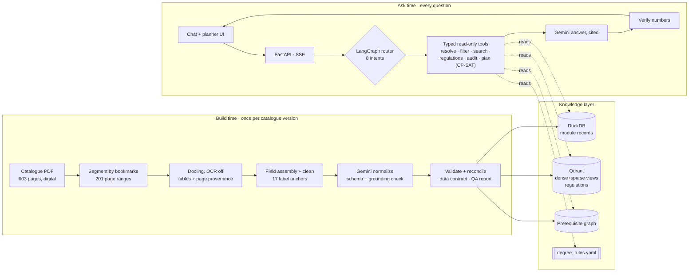

# Architecture & Technical Decisions

Current architecture: **v2, structured-first agentic hybrid RAG** (accepted 2026-11-25). Evidence, alternatives and code skeletons are in [IMPLEMENTATION_PLAN.md](IMPLEMENTATION_PLAN.md) §2–§6; progress is tracked in [ROADMAP.md](ROADMAP.md).

## Architecture

## Technology stack

| Component | Choice | Rationale |
|---|---|---|
| Segmentation | pypdfium2 bookmarks | Deterministic: all 188 numbered modules start on their bookmarked page |
| PDF parsing | Module fields: PDF text layer by geometry (pypdfium2, ADR-015). Front matter: Docling, OCR off, TableFormer `ACCURATE` | Lossless for the two-column module tables; Docling for complex tables and headings |
| Normalization | Rules first, Gemini structured output second, validation always | Exact where possible, schema-checked and grounded where not |
| System of record | DuckDB over `modules.jsonl` | Complete lists and exact aggregates |
| Semantic index | Qdrant (named dense + sparse vectors, payload indexes) | Hybrid search + filters + group-by-PN in one query |
| Embeddings / reranker | BGE-M3 / bge-reranker-v2-m3 (CPU) | Cross-lingual DE/EN; dense and sparse in one pass |
| Orchestration | LangGraph router + typed tools | Explicit, testable control flow |
| LLM | Google Gemini (Flash tier for routing/extraction, Pro tier for explanations) | Project decision; long context also powers baseline B1 |
| Planner | OR-Tools CP-SAT | Exact constraints and optimization |
| API / UI | FastAPI (SSE) + Chainlit or Streamlit (decided in P6) | Streaming chat, tool steps, feedback |
| Evaluation / tracing | Own metrics + selected Ragas metrics, Langfuse | Per-layer gates, traces, feedback |
| Tooling | uv, ruff, pyright, pytest + Hypothesis, Typer CLI (`sp`) | Reproducible, fast feedback |

## Key design decisions

| ADR | Decision | Status |
|---|---|---|
| ADR-001 | Docling over a custom regex parser | Decided (2026-10-10), still valid. The regex parser (former `test.py`) lives in `src/student_path/legacy/regex_parser.py` |
| ADR-002 | One module = one chunk | **Superseded** by ADR-010 |
| ADR-003 | Metadata schema keyed by `module_id` | **Superseded** by ADR-006 and the data model in IMPLEMENTATION_PLAN §6 |
| ADR-004 | Four agent intents | **Superseded** by ADR-011 (eight intents) |
| ADR-005 | Segment modules by PDF bookmark page ranges | Accepted 2026-11-25 |
| ADR-006 | PN (exam number) is the primary key; `module_id` is a non-unique attribute | Accepted 2026-11-25 |
| ADR-007 | OCR off; consume the DoclingDocument JSON, never the Markdown | Accepted 2026-11-25; **amended by ADR-015**: Docling is used for the front matter (overview tables, rules, regulations), not for module fields |
| ADR-008 | Extraction: deterministic first, LLM second, validate always | Accepted 2026-11-25 |
| ADR-009 | DuckDB is the system of record; Qdrant is a derived, rebuildable index | Accepted 2026-11-25 |
| ADR-010 | Multi-view indexing per module, grouped by PN at query time | Accepted 2026-11-25 |
| ADR-011 | Router + typed read-only tools; no free-form text-to-SQL in the main path | Accepted 2026-11-25 |
| ADR-012 | Planning and adjustment by CP-SAT over hand-encoded, cited degree rules | Accepted 2026-11-25 |
| ADR-013 | Evaluation-driven development: golden sets, baselines B0/B1, phase gates | Accepted 2026-11-25 |
| ADR-014 | Legacy v1 code is isolated in `student_path/legacy/` and `data/legacy/`, used only as the E1 baseline, deleted after P1 | Accepted 2026-11-25 |
| ADR-015 | Module fields are assembled from the PDF text layer by page geometry (labels left of x = 220 pt, values right of it), not from Docling's table grid | Accepted 2026-11-28 |

### ADR-002 to ADR-004: why they were superseded

- **ADR-002 (one chunk per module):** a module spans 2–6 pages of interleaved German and English text. One 1024-d vector for all of it dilutes meaning. Multi-view points grouped by PN keep precision while the LLM still sees the full record.
- **ADR-003 (`module_id` as key):** `5851` and `5853` each name two different modules, and 13 modules have no 4-digit ID. As Qdrant point IDs, one module would silently overwrite another. The exam number (PN) is unique for all 201 modules.
- **ADR-004 (four intents):** lists, regulations, degree audit and out-of-scope questions need their own machinery (SQL filters, passage search, the solver, abstention), so the router distinguishes eight intents.

### ADR-015: why module fields come from the text layer

- Docling's table grid loses text in long cells (F13: 24 pages below 99% coverage, worst 83.8%), merges label cells, and stretches header cells over several rows.
- Every module page has the same geometry: label text starts at x = 77-81 pt, value text at x >= 223 pt, nothing in between. Assigning the PDF's own text lines by position is lossless (P1.4 test: >= 99.9% of each module's words) and keeps a value that continues on the next page in its own field (the page-break bleed of F8 disappears).
- Measured on all 201 modules: every one of the 17 labels found exactly once; the only empty values are two rows the catalogue itself leaves blank (PN 568320); 1.3 s for the whole catalogue instead of 15 minutes.

The reasoning and evidence for ADR-005 to ADR-013 are in IMPLEMENTATION_PLAN §2 (findings F1–F12) and §5.2.

---

*Last updated: 2026-11-25*
