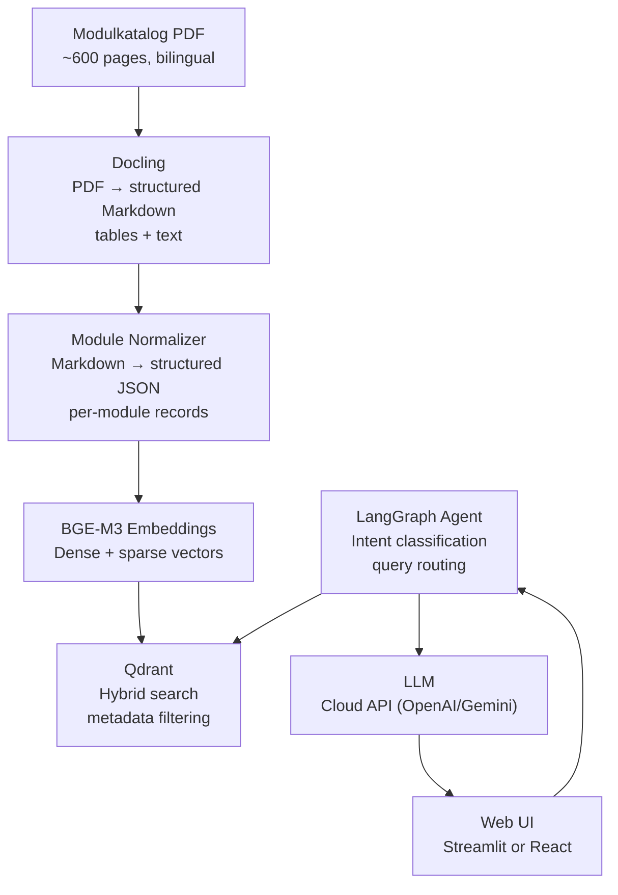

# Architecture & Technical Decisions

## Adapted Architecture



## Technology Stack

| Component | Choice | Rationale |
|---|---|---|
| **PDF Parsing** | Docling | Handles complex table layouts, OCR, retains structure. Enterprise guide uses same tool |
| **Module Normalization** | Custom Python script | Post-processes Docling output into clean per-module JSON records |
| **Embeddings** | BGE-M3 (via sentence-transformers or FlagEmbedding) | Multilingual (DE/EN), produces both dense and sparse vectors in one pass |
| **Vector DB** | Qdrant | Hybrid search support, metadata filtering, same as enterprise guide |
| **Reranker** | bge-reranker-v2-m3 | Same as enterprise guide, proven for multilingual content |
| **Agent** | LangGraph (via langgraph) | Same framework as enterprise guide, tool-calling agent pattern |
| **Backend** | FastAPI | Same as enterprise guide, clean API layer |
| **LLM** | OpenAI API or Google Gemini | Cloud API for simplicity. OpenAI-compatible interface allows swapping later |
| **Frontend** | Streamlit (MVP) → React (optional) | Streamlit for rapid iteration, upgrade later if desired |
| **Evaluation** | Ragas | Measurable retrieval and answer quality |

## Key Design Decisions

### ADR-001: Docling over custom regex parser (test.py)

**Status:** Decided  
**Date:** 2026-10-10

**Context:** An existing [test.py](../test.py) implements a custom regex-based parser that reads pipe-delimited markdown tables and normalizes them into JSON. It handles edge cases like hyphenated words split across lines and multi-line values.

**Evaluation of test.py:**
- ✅ Already works for the sample data (1 module parsed correctly)
- ✅ Handles continuation lines and hyphenation  
- ❌ **Fragile:** Relies on regex patterns that break with formatting variations
- ❌ **Assumes pre-extracted markdown:** Needs the PDF already converted to pipe-delimited text — doesn't solve the harder PDF parsing problem
- ❌ **Doesn't scale:** 600 pages of varied table formatting will produce many edge cases
- ❌ **Key detection is heuristic:** `is_new_key` logic using lowercase detection will misclassify German nouns (which are always capitalized)

**Decision:** Use **Docling** as the primary PDF parser (it's the same tool chosen in the enterprise guide). Docling handles:
- PDF → structured Markdown natively
- Table detection and extraction
- OCR for scanned content
- Heading structure preservation

After Docling extracts the raw structured content, a **lightweight normalizer** (simpler than test.py) cleans and structures the output into per-module JSON. The normalizer can borrow useful logic from test.py (like the `append_text` hyphenation handling) but won't need the fragile regex table parsing.

**Consequence:** test.py is kept as reference but not used in the pipeline. Its sample data is useful for testing the normalizer.

---

### ADR-002: One module = one chunk

**Status:** Decided  
**Date:** 2026-10-10

**Context:** The enterprise guide recommends structure-based chunking by headings (300-800 tokens). Course catalogue modules are self-contained records.

**Decision:** Each module becomes exactly one chunk. A typical module description fits within 400-700 tokens, which is within the recommended range. Benefits:
- No information loss across chunk boundaries
- Clean metadata attachment
- Simple retrieval: one result = one complete course

**Exception:** If any module exceeds ~1000 tokens (unlikely), split into "overview" and "details" sub-chunks with shared metadata.

---

### ADR-003: Metadata schema

**Status:** Decided  
**Date:** 2026-10-10

**Payload metadata per chunk (stored in Qdrant):**

```json
{
  "module_id": "5622",
  "module_name_de": "Software-Sicherheit",
  "module_name_en": "System Security",
  "ects": 5,
  "semester_offered": "summer",
  "language": ["de", "en"],
  "lecturer": "Posegga",
  "focus_area": "IT-SecRel",
  "prerequisites": ["Advanced IT Security"],
  "contact_hours_sws": 3,
  "assessment_types": ["exam", "presentation"],
  "workload_total_hours": 150
}
```

These enable filtered queries (e.g., "summer courses with 5+ ECTS in English").

---

### ADR-004: Agent intent types

**Status:** Decided  
**Date:** 2026-10-10

The LangGraph agent classifies student queries into four intents:

1. **Course lookup** — "Tell me about Software-Sicherheit" → direct Qdrant retrieval by module name/ID
2. **Recommendation** — "What security courses are offered in summer?" → semantic search + metadata filters
3. **Semester planning** — "Plan my 3rd semester with ~30 ECTS" → multi-retrieval with ECTS constraint satisfaction
4. **Comparison** — "Compare X vs Y" → retrieve both modules, structured side-by-side

---

*Last updated: 2026-10-10*
