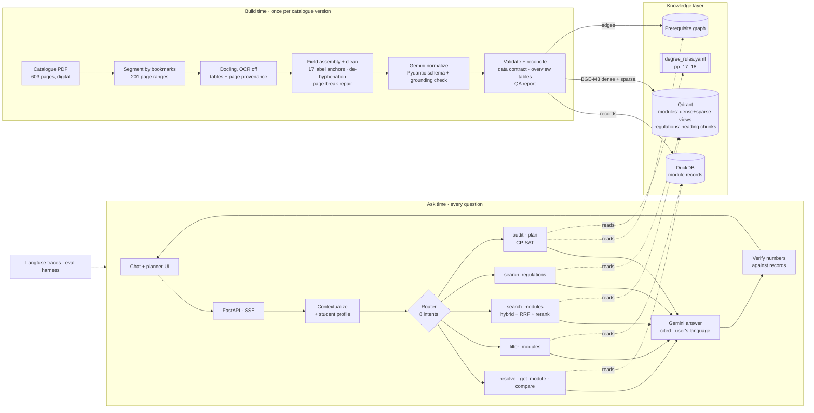

# Student-Path: Implementation Plan v2

**Structured-first agentic hybrid RAG for the M.Sc. Informatik module catalogue**

| | |
|---|---|
| Status | **Proposed** (2026-11-25). Once accepted, it revises ADR-002 and ADR-003 in [ARCHITECTURE.md](ARCHITECTURE.md) and replaces the phases in [ROADMAP.md](ROADMAP.md) |
| Visual companion | Architecture, evidence, approach scores, roadmap and mindmap: https://claude.ai/artifact/8uqJCGV3eCWAnEfdXHssPk (offline copy: [blueprint.html](blueprint.html)) |
| Evidence base | Measured on 2026-11-25 against `Modulkatalog-Master-Informatik.pdf` (Stand 13.10.2025), `data/raw/modulkatalog_docling.json` and `data/modules.json` (both moved to `data/legacy/` in P0.3) |
| LLM | Google Gemini (your decision, kept). Every other component is open source and runs locally on CPU |

## Contents

1. [TL;DR](#1-tldr)
2. [What the data told us](#2-what-the-data-told-us)
3. [The questions students will ask](#3-the-questions-students-will-ask)
4. [Approach evaluation](#4-approach-evaluation)
5. [Target architecture and decisions](#5-target-architecture-and-decisions)
6. [Data model](#6-data-model)
7. [Phase-by-phase guide](#7-phase-by-phase-guide)
8. [Evaluation strategy](#8-evaluation-strategy)
9. [Working like an expert with AI tools](#9-working-like-an-expert-with-ai-tools)
10. [Risks and mitigations](#10-risks-and-mitigations)
11. [References](#11-references)

---

## 1. TL;DR

1. **Docling is fine; the module segmentation is not.** Keep your existing Docling JSON, but cut modules by the PDF's own bookmarks and anchor rows on the 17 fixed field labels. In a spike, that raised the share of fields found per module from **47% to 99% on average** (98–100% per field) across all 201 modules. You do not need a new parser.
2. **The catalogue is a database in PDF form:** 201 modules × 17 fixed fields, plus degree rules (pp. 17–18) and overview tables (pp. 5–16). Make validated records the system of record, and use vectors for meaning, not for facts.
3. **Route each question to the right machinery:**
   - lookups → entity resolution plus the module record
   - "list all…" → typed SQL filters
   - "I'm into ML…" → hybrid dense+sparse search plus reranking
   - rule questions → passage RAG
   - "plan or adjust my semester" → a CP-SAT solver over records and rules

   A LangGraph router picks the path, Gemini writes the cited answer, and a verifier checks every number.
4. **Measure before you build features.** Build a golden set split by question type and two baselines: naive RAG, and the whole catalogue in Gemini's long context. Every phase ends with a metric gate.
5. **Effort:** about 28–41 focused days across 8 phases (about 6–8 weeks full-time, or one semester part-time). Each phase leaves a runnable system.

---

## 2. What the data told us

### 2.1 Findings

| # | Finding | Evidence | Consequence |
|---|---|---|---|
| F1 | The PDF is digital, not scanned | All 603 pages have a text layer (pypdfium2) | Set `do_ocr=False`: Docling's default is `True` ([legacy/parser.py:40](../src/student_path/legacy/parser.py#L40)). Runs are faster and OCR noise disappears |
| F2 | The PDF has a usable outline | 204 bookmarks. All 188 bookmarks with a 4-digit module ID point to the page where that module starts. Modules span 2–6 pages (median 3) | Segment modules by bookmark page ranges. This is deterministic and needs no regex boundary detection |
| F3 | There are exactly 201 modules | 201 bookmarks carry an exam number (PN); all 201 PNs are unique. One of them is the placeholder `xxxxxx` | Data contract: exactly 201 records |
| F4 | `module_id` is not a key | `5851` names both Software Process Engineering and Program Repair. `5853` names both Empirical Methods for SE and Programming Paradigms. 13 modules have no 4-digit ID (seminars, internship, thesis, 4 external modules) | **Primary key = PN.** With `module_id` as the Qdrant point ID, one module would silently overwrite another |
| F5 | The current `modules.json` is about half empty, and some records are merged | 271 records for 201 modules: table-of-contents rows became empty "ghost" records, and 85 IDs appear twice. A real module has a given field filled only about 48% of the time. ECTS is present and correct for 32.8%. Record "5670" contains text from 5710 and later modules. Values contain `-----` separator runs | Rebuild the normalizer (Phase 1) |
| F6 | Root causes of F5 | (a) TOC rows such as `\| 5487 \| AI-Driven … \|` match the new-module test `^\d{3,}$` ([legacy/normalizer.py:215](../src/student_path/legacy/normalizer.py#L215)). (b) Some header rows merge ID and title (`5710 Algorithmische … PN 455414`), so the test misses them and modules glue together. (c) Tables split at page breaks, and continuation rows have an empty label cell. (d) Docling repeats spanned cells, giving 4 columns instead of 2. (e) `language` defaults to `["de"]` when it is missing ([legacy/normalizer.py:134](../src/student_path/legacy/normalizer.py#L134)), which hides gaps. (f) `--pages` is parsed but never passed to `convert()` (fixed in P0.3) | Fix the segmentation, not the parser |
| F7 | Spike: same Docling JSON, new segmentation | Bookmark page ranges plus label anchors: 16 comparable fields are 98–100% filled; ECTS is a clean integer for 97.5% | The approach was validated before committing to it |
| F8 | What is still dirty | 50 `content` values start with a page-break fragment ("mic principles to practical requirements." is the tail of the learning outcomes). Also 11 `assessment` and 3 `literature` values. 2,124 hyphenation artifacts ("Nach- bearbeitung", "analy- sis"). German and English are interleaved in one value ("Keine None", "Jedes Sommersemester Every summer semester") | Add clean and normalize stages with grounding checks |
| F9 | The catalogue states its own rules | p. 17: ≥120 ECTS in total; ≥40 ECTS in one focus group (AlgMath, ProgSoft, InfKomm, ITS, IT-SecRel); ≥30 ECTS from the other focus groups plus General Area; compulsory Seminar 5 + Master's Thesis 27 + Presentation 3. p. 18: ≥20 ECTS by the end of semester 1, otherwise ≥30 by the end of semester 2 | Hand-encode them as `degree_rules.yaml`. The planner is a constraint solver |
| F10 | The catalogue contains its own ground truth | The overview tables on pp. 5–16 list PN, contact hours (SWS), ECTS, professor and language per module group | Reconcile extracted fields against them for free QA |
| F11 | The "Baukasten" (building blocks) on p. 18 is an image | Docling emits `<!-- image -->` | The rules are also in text on p. 17. Hand-encode them; describing the image with a VLM is optional |
| F12 | Hardware | CPU only (i7-11850H, 32 GB RAM, torch `+cpu`); Docker 29 available | BGE-M3 indexing is a cached one-off job on CPU. Budget cross-encoder reranking at about 15 short passages per query |

Page map: regulations pp. 3–4 (DE then EN) · module group overview pp. 5–16 · degree rules p. 17 · first-semester rule and Baukasten p. 18 · sample study plans pp. 20–21 · module descriptions from p. 32.

### 2.2 Spike result (old vs. new, same 201 modules)

| Field | Old `modules.json` | Bookmarks + label anchors |
|---|---:|---:|
| frequency (semester offered) | 48.3% | 98.5% |
| duration, convenor, lecturer, curriculum, contact hours, workload, assessment | 48.3% | 100% |
| ects | 35.3% | 99.0% |
| prereq formal / recommended | 47.8% / 47.3% | 99.0% / 99.0% |
| applicability, media | 48.3% | 99.5% |
| learning outcomes, literature | 47.3% / 47.8% | 98.5% |
| content | 48.3% | 98.0% |

"Old" counts a field as found if any record with the module's ID has a non-empty value. That is generous, because many of those values are merged or polluted.

### 2.3 What to keep from the current work

- The Docling choice and the raw Docling JSON: the spike reused it unchanged.
- `append_text`-style hyphen joining as one idea. It gets replaced by the corpus-aware version in P1.5.
- `test_questions.json`: migrate the 15 questions into the new golden-set format and key them by PN (`5622` becomes `405143`).
- The `context/` habit (PROJECT, ARCHITECTURE, ROADMAP, DEVELOPMENT_LOG). This is good context engineering; keep it up.

---

## 3. The questions students will ask

A single vector index cannot serve this mix of questions. Top-k retrieval returns k items, but "all English summer modules" can have 60 answers. ECTS arithmetic and rule checks must be exact.

| Type | Example | Why naive RAG fails | Handled by | Gate metric |
|---|---|---|---|---|
| Fact lookup | "How many ECTS is Software-Sicherheit?" (catalogue title: System Security) | DE/EN title mismatch; top-1 may be the wrong module | Entity resolver → DuckDB record → field | Exact match |
| Filtered list | "Welche IT-SecRel-Module gibt es im Sommer auf Englisch?" | Top-k truncates the list; filters are ignored | Typed filters → DuckDB, complete set | Set F1 = 1.0 |
| Discovery | "I like machine learning, what fits my focus?" | Works partly, but has no filters and gives no reasons | Hybrid dense+sparse, RRF, rerank, payload filters | Recall@10, nDCG@10 |
| Comparison | "Cryptography vs. Cryptanalysis?" | Retrieval can miss one side | Resolve both → side-by-side table | Field accuracy |
| Regulations | "How often can I retake a failed exam?" | Fine with good chunking | Heading-aware chunks of pp. 3–4 and 17–18 | Faithfulness |
| Semester plan | "Plan semester 2: about 30 ECTS, focus ITS, English only" | The LLM does arithmetic and produces invalid plans | CP-SAT over records + rules | 100% valid plans |
| Adjust / audit | "I failed Cryptography, what now?" · "What do I still need?" | Has no memory of the student's progress | Degree audit + re-solve with the fewest changes | Validity, stability |
| Out of scope | "When is the System Security exam?" | Invents dates | Abstain and point to official channels | Abstention rate |

---

## 4. Approach evaluation

### 4.1 Candidates

| | Approach | One-line description |
|---|---|---|
| A0 | Naive RAG | Chunk → embed → top-k → LLM |
| A1 | Advanced RAG | Hybrid dense+sparse, reranker, metadata filters, query rewriting (≈ your v1 plan) |
| A2 | Text-to-SQL only | LLM writes SQL over a module table |
| A3 | GraphRAG | LLM-extracted knowledge graph plus community summaries |
| A4 | Long context | The whole catalogue in Gemini's 1M-token context (with context caching) |
| A5 | **Structured-first agentic hybrid** | Validated records + hybrid vector index + router + typed tools + CP-SAT planner + verifier |

### 4.2 Weighted decision matrix

Scores are design judgments from 1 (poor) to 5 (strong). "Ease" means 5 = easiest to build. Phase 2 replaces the judgments with measurements for A0 (baseline B0), A4 (baseline B1) and A5.

| Approach | Lookup (15) | Lists (15) | Discovery (15) | Rules (10) | Planning (15) | Trust (10) | Cost/latency (10) | Ease (5) | Transfer to enterprise project (5) | **Score / 100** |
|---|---:|---:|---:|---:|---:|---:|---:|---:|---:|---:|
| A0 Naive RAG | 3 | 1 | 3 | 3 | 1 | 2 | 5 | 5 | 2 | **51** |
| A1 Advanced RAG | 4 | 2 | 4 | 4 | 1 | 3 | 4 | 4 | 4 | **63** |
| A2 Text-to-SQL only | 4 | 5 | 1 | 1 | 2 | 3 | 4 | 3 | 3 | **58** |
| A3 GraphRAG | 3 | 3 | 4 | 3 | 2 | 3 | 2 | 2 | 3 | **57** |
| A4 Long context | 4 | 3 | 4 | 4 | 2 | 2 | 1 | 5 | 1 | **59** |
| **A5 Structured-first agentic hybrid** | 5 | 5 | 5 | 4 | 5 | 5 | 3 | 1 | 5 | **90** |

Score = Σ(score × weight) / 5.

### 4.3 Decision: A5

- It is the only option that scores at least 4 on every question type. The others each fail at least one type badly: lists (A0, A1), discovery (A2), planning (A0–A4), or cost (A4).
- **It contains A1** as its discovery subsystem and uses **A4 as a baseline**. You are not betting everything on complexity: every phase delivers a working system that is measured against the cheaper alternatives.
- **Its main risk is build effort (Ease = 1).** Phase gates and a stretch list contain that risk.
- It transfers to your enterprise project, roughly one-to-one:
  - module records → asset and fault records
  - degree rules → maintenance rules
  - typed SQL tools → MySQL views

### 4.4 What we deliberately do not do

| Not doing | Why |
|---|---|
| Fine-tune an LLM on the catalogue | Knowledge injection by fine-tuning is unreliable, gives no citations, and is stale after the next catalogue release |
| Full GraphRAG (LLM-built graph + community summaries) | The relationships are few and explicit (groups, recommended skills, lecturers), so we extract them deterministically |
| Free-form text-to-SQL in the main path | Typed, read-only tools are safer and testable. Guarded text-to-SQL stays as a stretch exercise that mirrors the enterprise project's MySQL views |
| One vector per module (old ADR-002) | 3 pages of mixed DE/EN text in one 1024-d vector dilutes meaning. Use multi-view points grouped by PN instead (ADR-010) |
| OCR | The PDF has a full text layer (F1) |

---

## 5. Target architecture and decisions



### 5.1 Components

| Layer | Choice | Why | Considered instead |
|---|---|---|---|
| Segmentation | pypdfium2 bookmarks | Deterministic; 188/188 verified | Regex over Markdown (current; fails) |
| Parsing | Docling: OCR off, TableFormer `ACCURATE`, cell matching on | Already in your stack and in the enterprise project; page provenance for citations | pdfplumber word boxes (a good fallback; compare in experiment E1) |
| Normalization | Rules first; Gemini Flash-tier structured output for DE/EN splitting, assessment parts and prerequisite mentions | Cheap and schema-checked; the grounding check stops invention | All-LLM extraction (costlier, harder to trust) |
| System of record | DuckDB over `modules.jsonl` | Exact filters and aggregates, list columns, no server | SQLite (also fine), Postgres (overkill) |
| Semantic index | Qdrant: named dense (1024) + sparse vectors, payload indexes, a collection alias per version | Hybrid search + filter + `group_by` in one call; embedded mode for development (verified) | Chroma, pgvector (weaker hybrid support) |
| Embeddings | BGE-M3 via FlagEmbedding | Cross-lingual DE/EN; dense and sparse in one pass | multilingual-e5, Gemini embeddings (experiment E6) |
| Reranker | bge-reranker-v2-m3 on ≤15 short card texts | Multilingual; fits a CPU budget | ONNX int8 export; skip when filters leave ≤15 candidates |
| Orchestration | LangGraph router + typed tools | Explicit, testable control flow; checkpointer gives memory | One free-form ReAct agent (less predictable) |
| LLM | Gemini: Flash tier for routing and extraction, Pro tier for plan explanations; via `langchain-google-genai` and `google-genai` | Your decision; its long context also powers baseline B1 | — |
| Planner | OR-Tools CP-SAT | Exact constraint satisfaction and optimization in milliseconds | LLM planning (invalid plans), PuLP ILP (also fine) |
| API / UI | FastAPI (SSE) + Chainlit or Streamlit | Streaming chat, step display, feedback buttons | React (later) |
| Eval & observability | Own metrics + selected Ragas metrics + Langfuse | Per-layer metrics, traces, feedback scores | Arize Phoenix (lighter local option) |
| Tooling | uv, ruff, pyright, pytest + Hypothesis, pre-commit, Docker Compose, Typer CLI | Reproducible, fast feedback | `pip` + `requirements.txt` (used before P0.2) |

### 5.2 Decisions (proposed ADRs; append them to ARCHITECTURE.md when accepted)

| ADR | Decision | Reason |
|---|---|---|
| ADR-005 | Segment modules by PDF bookmark page ranges | F2, F6. TOC rows can no longer create modules; a test asserts 201 |
| ADR-006 | PN is the primary key; `module_id` is a non-unique attribute. Qdrant point IDs = `uuid5(NS, f"{pn}:{view}:{lang}")` | F4. The single `xxxxxx` PN gets the synthetic key `new-<module_id>` |
| ADR-007 | OCR off; consume the DoclingDocument JSON, never the Markdown | F1. `prov.page_no` is kept for page-level citations |
| ADR-008 | Extraction is deterministic first, LLM second, validated always | The LLM gets a response schema and a grounding check, prefers returning offsets or labels over rewritten text, and is cached by (prompt version, model, input hash) |
| ADR-009 | DuckDB is the system of record; Qdrant is a derived, rebuildable index | Lists and aggregates never come from top-k |
| ADR-010 | Multi-view indexing (revises ADR-002) | Per module: `card`, `content_en/de` and `outcomes_en/de` points, grouped by PN at query time. The LLM sees the full record |
| ADR-011 | Router + typed, read-only tools; no free-form text-to-SQL in the main path | Safety and testability |
| ADR-012 | Planning and adjustment by CP-SAT over hand-encoded, cited degree rules | The LLM only translates requests and explains results |
| ADR-013 | Evaluation-driven development | Dev/test golden sets, baselines B0/B1, a gate per phase, a CI regression check |

---

## 6. Data model

### 6.1 Module record (system of record)

```python
# src/student_path/domain/models.py  (skeleton)
from enum import StrEnum
from typing import Literal
from pydantic import BaseModel, Field

class Season(StrEnum):
    WINTER = "winter"
    SUMMER = "summer"

class Cadence(StrEnum):
    EVERY_SEMESTER = "every_semester"
    YEARLY = "yearly"                       # "Jedes Sommersemester"
    EVERY_OTHER_YEAR = "every_other_year"   # "Mindestens jedes 2. Sommersemester"
    IRREGULAR = "irregular"                 # "Unregelmäßig"
    DISCONTINUED = "discontinued"           # "Modul wird nicht mehr angeboten"
    UNKNOWN = "unknown"

class Group(StrEnum):
    ALGMATH = "AlgMath"
    PROGSOFT = "ProgSoft"
    INFKOMM = "InfKomm"
    ITS = "ITS"
    ITSECREL = "IT-SecRel"
    ALLGBER = "AllgBer"
    COMPULSORY = "Compulsory"

class Bilingual(BaseModel):
    de: str | None = None
    en: str | None = None

class Offering(BaseModel):
    seasons: list[Season] = []
    cadence: Cadence = Cadence.UNKNOWN
    raw: str

class Teaching(BaseModel):                 # "2V + 1Ü" -> lecture 2, exercise 1 (SWS)
    lecture_sws: float = 0
    exercise_sws: float = 0
    seminar_sws: float = 0
    lab_sws: float = 0
    raw: str

class AssessmentPart(BaseModel):
    kind: Literal["written_exam", "oral_exam", "presentation", "project",
                  "report", "portfolio", "homework", "other"]
    minutes: int | None = None
    weight_pct: int | None = None
    note_en: str | None = None

class SourceRef(BaseModel):
    pdf_sha256: str
    catalogue_version: str                 # "2025-10-13"
    page_start: int
    page_end: int

class Module(BaseModel):
    pn: str                                # primary key (exam number)
    module_id: str | None                  # NOT unique: 5851, 5853
    title: Bilingual
    ects: int = Field(ge=1, le=30)
    groups: list[Group]
    offering: Offering
    duration_semesters: int = 1
    languages: list[Literal["de", "en"]]
    convenors: list[str]
    lecturers: list[str]
    teaching: Teaching
    workload_hours: int | None
    has_formal_prereq: bool
    prereq_formal: Bilingual
    prereq_recommended: Bilingual
    recommended_pns: list[str] = []        # resolved by entity linking (P1.9)
    applicability: list[str] = []
    learning_outcomes: Bilingual
    content: Bilingual
    assessment: list[AssessmentPart]
    assessment_raw: Bilingual
    media: Bilingual
    literature: str | None
    summary_en: str | None = None          # LLM-generated; marked as generated in the UI
    keywords_en: list[str] = []
    source: SourceRef
    quality_flags: list[str] = []          # e.g. "bleed_repaired", "ects_mismatch_overview"
```

### 6.2 DuckDB (filters and aggregates)

```sql
CREATE OR REPLACE TABLE modules AS
SELECT * FROM read_json_auto('data/processed/modules.jsonl');

-- what filter_modules() generates: parameters only, never string-built SQL
SELECT pn, title.en AS title, ects, offering.seasons AS seasons
FROM modules
WHERE list_contains(groups, $group)
  AND list_contains(offering.seasons, $season)
  AND list_contains(languages, 'en')
ORDER BY ects DESC;
```

### 6.3 Qdrant collections

| Collection | One point per | Vectors | Payload (indexed fields in bold) |
|---|---|---|---|
| `modules_v1` (alias `modules`) | (pn, view, lang); views are `card`, `content`, `outcomes`; about 1,000 points | `dense` (1024, cosine), `sparse` (BGE-M3 lexical weights) | **pn**, **groups**, **seasons**, **languages**, **cadence**, **ects**, **has_formal_prereq**, view, lang, title_en, title_de, page_start |
| `regulations_v1` | heading-aware chunk of pp. 3–4 and 17–21 | same | heading_path, page, lang |

The `card` text is "{title.en} / {title.de}. Groups: … {ects} ECTS, {offering}, taught in {languages}. Lecturers: … {summary_en} Keywords: …". It is the view that best matches names and topics, and it is what the reranker reads.

### 6.4 Degree rules (hand-encoded, cited, unit-tested)

```yaml
# config/degree_rules.yaml
catalogue_version: "2025-10-13"
total_min_ects: 120                          # p. 17, FStuPO § 6
compulsory:                                  # p. 16 "Compulsory Modules"
  - {pn: "450001", name: "Seminar", ects: 5}
  - {pn: "458999", name: "Presentation of the Master's Thesis", ects: 3}
  - {pn: "459900", name: "Master's Thesis in Computer Science", ects: 27}
focus_groups: [AlgMath, ProgSoft, InfKomm, ITS, IT-SecRel]
focus_min_ects: 40                           # p. 17 (ii)
other_groups_plus_general_min_ects: 30       # p. 17 (iii): other focus groups + AllgBer
early_progress:                              # p. 18, AStuPO § 9 (3)
  - {by_end_of_semester: 1, min_ects: 20}
  - {by_end_of_semester: 2, min_ects: 30, applies_if_previous_missed: true}
ects_hours: 30                               # p. 3: 1 ECTS ≈ 30 hours of work
```

---

## 7. Phase-by-phase guide

Each phase has a goal, steps, the key code shape, pitfalls, a **Definition of Done (DoD)** with measurable gates, and what you learn from it. The targets are starting points: after P2, set the gates relative to the measured baselines.

| Phase | Focused days | Gate (short) |
|---|---:|---|
| P0 Foundations | 1–2 | Repo, env, tests, Qdrant ready |
| P1 Data foundation v2 | 5–7 | 201/201 records, PN unique, ECTS = overview tables, ≥95% field accuracy |
| P2 Eval harness + baselines | 3–4 | Scorecards for B0 and B1 |
| P3 Retrieval layer | 4–6 | Resolver ≥0.97, list F1 = 1.0, Recall@10 ≥0.90, p95 ≤1.5 s |
| P4 Agent, generation, API | 5–7 | Correctness ≥0.85, faithfulness ≥0.90, citations ≥0.95, abstention ≥0.90 |
| P5 Planner, audit, adjustment | 4–6 | 100% valid plans on 30 scenarios, solve ≤2 s |
| P6 Product UI | 3–5 | 5 student tasks completed unaided |
| P7 Hardening & release | 3–4 | One-command start, CI eval gate, v1.0 report |
| P8 Stretch | open | Pick by interest |

### P0: Foundations (1–2 days)

**Goal:** a professional skeleton, so every later step is fast to run, test and undo.

1. `git init`. Add a `.gitignore` covering `.venv/`, `.env`, `data/interim/`, `data/qdrant/`, `data/raw/*.json` and `*.sqlite`. Commit the PDF once, or record its SHA-256 instead. The project is not under version control yet; fix that first.
2. `uv init --package`, then move dependencies from `requirements.txt` into dependency groups so the heavy ML stack stays optional:

   ```toml
   [dependency-groups]
   ingest = ["docling", "pypdfium2"]
   ml     = ["FlagEmbedding", "torch"]
   serve  = ["fastapi", "uvicorn", "langgraph", "langgraph-checkpoint-sqlite",
             "langchain-google-genai", "google-genai", "qdrant-client", "duckdb",
             "rapidfuzz", "ortools", "langfuse"]
   ui     = ["chainlit"]          # or streamlit
   eval   = ["ragas"]
   dev    = ["ruff", "pyright", "pytest", "hypothesis", "pre-commit"]

   [tool.uv.sources]
   torch = { index = "pytorch-cpu" }

   [[tool.uv.index]]
   name = "pytorch-cpu"
   url = "https://download.pytorch.org/whl/cpu"
   explicit = true
   ```

3. Layout: move `src/ingestion/` into a package and keep `context/`. *(Done 2026-11-25: package, `sp` CLI, typed settings, PDF moved to `data/source/`. The v1 code is isolated in `student_path/legacy/` (`sp legacy parse|normalize`) and its outputs in `data/legacy/`; it is only the experiment E1 baseline. `student_path.ingestion` is reserved for the v2 pipeline (P1). Add the other subpackages and folders when their phase starts, not as empty stubs.)*

   ```
   src/student_path/
     domain/      models.py, rules.py
     ingestion/   probe.py, segment.py, fields.py, clean.py, normalize_llm.py, link.py, validate.py, views.py, index.py
     store/       sql.py (DuckDB), vector.py (Qdrant), graph.py
     retrieval/   resolve.py, filters.py, hybrid.py, rerank.py, regulations.py
     planner/     audit.py, cpsat.py, explain.py
     agent/       state.py, graph.py, nodes.py, tools.py
     api/         main.py
     cli.py       # Typer: sp ingest | sp index | sp eval | sp serve
     settings.py  # pydantic-settings (code must live in the package to be importable)
   config/        degree_rules.yaml, prompts/*.md
   data/          source/  interim/  processed/  gold/
   eval/          datasets/  baselines/  metrics.py  run_eval.py  reports/
   tests/
   ```

4. `src/student_path/settings.py` with pydantic-settings reading `.env` *(done in P0.3)*. Extend `.env.example` with `GEMINI_FAST_MODEL`, `GEMINI_SMART_MODEL` (pin exact model versions for reproducible evals; aliases drift), `QDRANT_PATH=data/qdrant` (embedded) or `QDRANT_URL`, and the `LANGFUSE_*` keys.
5. Pre-commit with ruff (lint + format). Add pytest with one smoke test, and pyright in basic mode.
6. `docker-compose.yml` with `qdrant/qdrant` (pin a version tag). Start with embedded Qdrant (`QdrantClient(path=...)`) and switch to the server in P7.
7. Write a `CLAUDE.md` (or `AGENTS.md`) of at most 100 lines: purpose, commands, layout, conventions and a "never" list (see §9).

**DoD:** `uv run pytest` passes · `uv run sp --help` works · `git log` shows a first commit.
**You learn:** reproducible Python projects, packaging, configuration.

### P1: Data foundation v2 (5–7 days)

**Goal:** 201 validated, typed module records plus a QA report you trust. This phase decides your answer quality more than any model choice does.

**P1.1 Probe.** Write `data/processed/manifest.json` with the SHA-256, page count, text-layer check, catalogue date (from p. 1) and bookmark count.

**P1.2 Re-run Docling once,** properly configured, and cache the result as `data/interim/docling.json`:

```python
from docling.datamodel.base_models import InputFormat
from docling.datamodel.pipeline_options import PdfPipelineOptions, TableFormerMode
from docling.document_converter import DocumentConverter, PdfFormatOption

opts = PdfPipelineOptions()
opts.do_ocr = False                                   # F1: digital PDF
opts.do_table_structure = True
opts.table_structure_options.mode = TableFormerMode.ACCURATE
opts.table_structure_options.do_cell_matching = True  # use the PDF's own text cells
converter = DocumentConverter(format_options={InputFormat.PDF: PdfFormatOption(pipeline_options=opts)})
doc = converter.convert("data/source/Modulkatalog-Master-Informatik.pdf").document
doc.save_as_json("data/interim/docling.json")
```

Compare the runtime with your OCR run and write the number in the development log.

**P1.3 Segment by bookmarks.**

```python
# src/student_path/ingestion/segment.py
import re
import pypdfium2 as pdfium
from pydantic import BaseModel

PN_RE = re.compile(r"PN\s*([0-9x]{6})")
ID_RE = re.compile(r"^\s*(\d{4,5})\b")

class Segment(BaseModel):
    pn: str
    module_id: str | None
    title_raw: str
    page_start: int          # 1-based, inclusive (Docling's page_no)
    page_end: int

def segment_modules(pdf_path: str) -> list[Segment]:
    pdf = pdfium.PdfDocument(pdf_path)
    marks = []
    for bm in pdf.get_toc():
        dest = bm.get_dest()
        if dest is not None:
            marks.append((bm.get_title() or "", dest.get_index() + 1))
    mods = [(t, p) for t, p in marks if PN_RE.search(t)]
    segments = []
    for i, (title, start) in enumerate(mods):
        end = mods[i + 1][1] - 1 if i + 1 < len(mods) else len(pdf)
        pn = PN_RE.search(title).group(1)
        mid = ID_RE.match(title)
        module_id = mid.group(1) if mid else None
        if pn == "xxxxxx":
            pn = f"new-{module_id}"
        segments.append(Segment(pn=pn, module_id=module_id, title_raw=title.strip(),
                                page_start=start, page_end=end))
    return segments
```

Front-matter segments get fixed page ranges: regulations 3–4, overview 5–16, rules 17–18, sample plans 20–21.
Test: `len(segments) == 201`, PNs unique, and every module ID appears in the first lines of its start page.

**P1.4 Field assembly with label anchors.** This uses the docling-core API (verified against your installed version):

```python
# src/student_path/ingestion/fields.py
import re
from docling_core.types.doc import DoclingDocument, TableItem, TextItem

LABELS = {
    "frequency": r"Häufigkeit des Modul|Frequency of course",
    "duration": r"Moduldauer|Module duration",
    "convenor": r"Modulverantwortliche|Module convenor",
    "lecturer": r"Dozent|Lecturer",
    "language": r"Sprache|Language of instr",
    "curriculum": r"Zuordnung zum Curr",
    "contact_hours": r"Lehrform|Contact hours",
    "workload": r"Arbeitsaufwand|Workload",
    "ects": r"ECTS",
    "prereq_formal": r"Voraussetzungen nach|Required prereq",
    "prereq_recommended": r"Empfohlene Vork|Recommended skills",
    "applicability": r"Verwendbarkeit|Applicability",
    "learning_outcomes": r"Angestrebte Lern|Learning outcomes",
    "content": r"Inhalt|Course content",
    "assessment": r"Studien-?/?\s*Prüfungsl|Assessment",
    "media": r"Medienformen|Media used",
    "literature": r"Literatur|Reading list",
}
LABEL_RE = {k: re.compile(rf"^\s*(?:{v})", re.IGNORECASE) for k, v in LABELS.items()}

def label_of(cell: str) -> str | None:
    return next((k for k, rx in LABEL_RE.items() if rx.match(cell)), None)

def row_cells(row) -> list[str]:
    """Docling repeats the text of spanned cells: keep each text once, in order."""
    out: list[str] = []
    for cell in row:
        text = (cell.text or "").strip()
        if text and (not out or out[-1] != text):
            out.append(text)
    return out

def assemble_fields(doc: DoclingDocument, page_start: int, page_end: int) -> dict[str, str]:
    fields: dict[str, list[str]] = {}
    current: str | None = None                    # survives table AND page boundaries
    for item, _ in doc.iterate_items():           # reading order; page headers/footers excluded
        page = item.prov[0].page_no if item.prov else None
        if page is None or not page_start <= page <= page_end:
            continue
        if isinstance(item, TableItem):
            for row in item.data.grid:
                cells = row_cells(row)
                if not cells:
                    continue
                first = (row[0].text or "").strip()
                label = label_of(first) if first else None
                if label:
                    current = label
                    fields.setdefault(label, []).extend(c for c in cells[1:] if label_of(c) != label)
                elif current:                     # continuation row or sub-heading row
                    fields[current].extend(cells)
                # rows before the first label = module header (ID, title, PN): already known
        elif isinstance(item, TextItem) and current:
            fields[current].append(item.text)     # e.g. "Fähigkeiten / Abilities" outside tables
    return {k: " ".join(v) for k, v in fields.items()}
```

The spike version reset `current` for each table and ignored text items. The two changes above close most of the remaining 1–2% gap. Check them against the 20 gold modules.

**P1.5 Clean.** Apply Unicode NFKC, collapse whitespace, then de-hyphenate using the corpus itself as the dictionary:

```python
# src/student_path/ingestion/clean.py
import re
from collections import Counter

KEEP_AFTER = {"und", "oder", "bzw", "sowie", "and", "or"}      # "Informations- und …"
HYPH = re.compile(r"(\w+)-\s+(\w+)")

def build_vocab(texts: list[str]) -> Counter:
    return Counter(w.lower() for t in texts for w in re.findall(r"[\w-]+", t))

def dehyphenate(text: str, vocab: Counter) -> str:
    def fix(m: re.Match) -> str:
        a, b = m.group(1), m.group(2)
        if b.lower().rstrip(".") in KEEP_AFTER:
            return f"{a}- {b}"
        if b[0].isupper():
            return f"{a}-{b}"                                     # "IT- Sicherheit" -> "IT-Sicherheit"
        joined, hyphened = f"{a}{b}", f"{a}-{b}"
        if vocab[joined.lower()] or not vocab[hyphened.lower()]:
            return joined                                         # "Nach- bearbeitung" -> "Nachbearbeitung"
        return hyphened
    return HYPH.sub(fix, text)
```

Gate: fewer than 20 artifacts remain, down from 2,124. Tip: pypdfium2's text layer marks line-break hyphens as `U+FFFE`, which gives a second, independent signal for checking your rule.

**P1.6 Page-break bleed repair.** A value that starts with a lowercase fragment (50 `content` values) usually begins with the tail of the previous field.
- **Heuristic first:** if `prev` ends mid-word and `fragment + next word` forms a vocabulary word, move the fragment back.
- **Otherwise, ask the LLM for an offset, not text:** `{"move_chars": int}`, the number of leading characters of field B that belong to field A. Code applies the move. An integer cannot hallucinate prose.

**P1.7 Rule-based typing.** First list the distinct raw values per field; there are only a few dozen phrasings. Map them with a hand-made table, and send only the leftovers to the LLM.
- ECTS → int
- "2V + 1Ü" → `Teaching`
- Workload hours: sum of `(\d+)\s*(Std|hrs|h)` in one language
- Frequency → `Offering`
- Language → list
- `Modulgruppe "X"` → `groups`
- People: split on `,`, `/`, `und`, `and`

**P1.8 LLM normalization** (Gemini Flash tier, temperature 0, structured output), only for what rules cannot do:
- the DE/EN split of long fields
- assessment parts
- prerequisite mentions
- a 2–3 sentence `summary_en` plus keywords for the card view

```python
# src/student_path/ingestion/normalize_llm.py  (skeleton)
import hashlib, json
from google import genai
from google.genai import types
from rapidfuzz import fuzz

PROMPT_VERSION = "normalize-v1"            # prompt lives in config/prompts/normalize-v1.md
client = genai.Client()                    # API key from the environment

class LLMFields(BaseModel):
    learning_outcomes: Bilingual
    content: Bilingual
    assessment: list[AssessmentPart]
    prerequisite_mentions: list[str]       # course names exactly as written
    summary_en: str                        # generated, flagged downstream
    keywords_en: list[str]

def normalize(pn: str, fields: dict[str, str], cache) -> LLMFields:
    payload = json.dumps(fields, ensure_ascii=False, sort_keys=True)
    key = hashlib.sha256(f"{PROMPT_VERSION}|{settings.gemini_fast_model}|{payload}".encode()).hexdigest()
    if (hit := cache.get(key)) is not None:
        return LLMFields.model_validate_json(hit)
    resp = client.models.generate_content(
        model=settings.gemini_fast_model,
        contents=load_prompt(PROMPT_VERSION).format(fields=payload),
        config=types.GenerateContentConfig(
            temperature=0,
            response_mime_type="application/json",
            response_schema=LLMFields,
        ),
    )
    out: LLMFields = resp.parsed
    if problems := ungrounded_spans(out, fields):   # copied text must exist in the source
        raise ExtractionError(pn, problems)         # or retry once, listing the problems
    cache.set(key, out.model_dump_json())
    return out

def grounded(span: str, source: str, min_score: float = 95) -> bool:
    return fuzz.partial_ratio(squash(span), squash(source)) >= min_score
```

Prompt rules for `normalize-v1.md`:
- Copy text exactly. Never translate, summarize or fix wording, except in `summary_en` and `keywords_en`.
- If only one language is present, set the other one to null.
- Drop label text that leaked into a value.

Deterministic alternative to compare (experiment E1b): sentence-level language ID with `lingua` for the DE/EN split.

**P1.9 Entity linking.** Resolve prerequisite mentions to PNs:
1. Build an alias table: DE and EN titles, overview-table names, PN, module ID.
2. Match with rapidfuzz `WRatio`.
3. Send ambiguous top-2 cases to the LLM to choose.
4. Unresolved mentions (often Bachelor courses) stay as text marked `external`.

The resolved links become `prereq_edges.jsonl`, the prerequisite graph.

**P1.10 Reconcile with the overview tables** (pp. 5–16). Parse those clean tables, join on PN, and compare ECTS, SWS, language and professor. Also derive group membership: a module can sit in several groups.

**P1.11 Data-contract tests** that fail the pipeline:

```python
# tests/test_data_contract.py
def test_exactly_201_unique_modules(modules):
    assert len(modules) == 201
    assert len({m.pn for m in modules}) == 201

def test_ects_matches_overview(modules, overview):
    bad = [(m.pn, m.ects, overview[m.pn].ects) for m in modules
           if m.pn in overview and m.ects != overview[m.pn].ects]
    assert not bad, bad

def test_workload_close_to_30h_per_ects(modules):
    off = [m.pn for m in modules
           if m.workload_hours and abs(m.workload_hours - 30 * m.ects) > 3 * m.ects]
    assert len(off) <= 3, off                  # explain each exception in qa_report.md

def test_no_table_artifacts(modules):
    for m in modules:
        blob = m.model_dump_json()
        assert "-----" not in blob and "Course content" not in blob, m.pn
```

**P1.12 QA report and gold labels.**
1. Generate `data/processed/qa_report.md` with fill rates, mismatches and flagged modules.
2. Read 30 random modules next to the PDF; this is your enterprise guide's own advice.
3. Hand-label 20 modules into `data/gold/extraction_gold.jsonl`. Stratify them: short and long, 2- and 4-column tables, multi-page, no-ID modules, and both 5851 modules.

**DoD:**
- 201/201 records and unique PNs
- ≥99% fill on core fields
- ECTS agrees with the overview tables for every module (each mismatch explained)
- field accuracy on gold ≥95% (normalized similarity ≥0.95 for long text)
- zero `-----` runs; fewer than 20 hyphen artifacts

**You learn:** document AI, data profiling, data contracts, LLM structured extraction, entity resolution.
**Enterprise transfer:** the same pattern applies to manuals (outline segmentation, provenance, QA report).

### P2: Evaluation harness and baselines (3–4 days)

**Goal:** one command that scores any system version per question type. This phase also builds your **walking skeleton**: baseline B0 runs end to end.

1. **Golden set format** (`eval/datasets/golden.jsonl`):

   ```json
   {"id": "L-017", "split": "dev", "type": "list", "lang": "en", "difficulty": "medium",
    "question": "Which IT-SecRel modules run in the summer semester and are taught in English?",
    "expected": {"pns": ["405143", "..."]}, "source": "template:list_group_season_lang"}
   ```

2. **Programmatic items (~80).** Fill templates with values and compute the exact answer from DuckDB:
   - "How many ECTS is {title}?"
   - "Wer ist Dozent von {title_de}?"
   - "Which {group} modules run in {season} in English?"
   - "Compare {a} and {b}"

   Then have Gemini paraphrase them and make about half of them German. These answers are exact by construction.
3. **Hand-written items (~70):**
   - 20 regulation questions (pp. 3–4, 17–18)
   - 20 discovery questions with graded relevance (0–2). Pool candidates from sparse, dense and LLM judgments, then check them yourself.
   - 15 planning and adjustment scenarios (profile + request → constraints to check)
   - 15 out-of-scope or adversarial questions: exam dates, rooms, other universities, prompt injection
   - your 15 existing questions
4. Freeze a **dev/test split** at 70/30. Tune only on dev, and report on test.
5. **Metrics** (`eval/metrics.py`). Implement the deterministic ones yourself:

   ```python
   def recall_at_k(ranked: list[str], relevant: set[str], k: int) -> float:
       return len(set(ranked[:k]) & relevant) / max(len(relevant), 1)

   def mrr(ranked: list[str], relevant: set[str]) -> float:
       return next((1 / (i + 1) for i, pn in enumerate(ranked) if pn in relevant), 0.0)

   def set_f1(pred: set[str], gold: set[str]) -> float:
       if not pred and not gold:
           return 1.0
       p = len(pred & gold) / max(len(pred), 1)
       r = len(pred & gold) / max(len(gold), 1)
       return 0.0 if p + r == 0 else 2 * p * r / (p + r)
   ```

   Use Ragas (or your own rubric judge) for faithfulness and answer correctness. Add citation precision, abstention accuracy, plan validity, latency p50/p95, tokens and cost.
6. **Calibrate the judge.** Label 30 answers yourself. Trust the LLM judge only when it agrees with you on at least 85% of them. Gemini judging Gemini favors itself, so use reference answers and a rubric.
7. **Baselines:**
   - **B0 Naive RAG:** one vector per module (old ADR-002), dense only, top-5, no router.
   - **B1 Long context:** all 201 cleaned records (English fields) in one cached Gemini prompt.
8. `uv run sp eval --suite dev --system b0|b1|v1` writes `eval/reports/<date>-<system>.md` with a per-type table.

**DoD:** scorecards for B0 and B1 exist and their numbers are in the development log · the split is frozen · the judge is calibrated.
**You learn:** evaluation design, IR metrics, LLM-as-judge calibration, why baselines keep you honest.

### P3: Retrieval layer (4–6 days)

**Goal:** each question type gets machinery that is right by construction where possible, and measured everywhere.

1. **DuckDB store** plus a `filter_modules(group=None, season=None, language=None, ects_min=None, ects_max=None, has_formal_prereq=None, cadence=None)` query builder with parameters only. Lists are always complete.
2. **Entity resolver:**

   ```python
   import re
   from rapidfuzz import fuzz, process

   def resolve(mention: str, aliases: dict[str, list[str]], by_id: dict[str, list[str]], limit: int = 3):
       """aliases: alias -> [pn]; by_id: module_id -> [pn] (5851 maps to two PNs)."""
       if m := re.fullmatch(r"\s*(?:PN\s*)?(\d{6})\s*", mention):
           return [(m.group(1), 100.0)]
       if m := re.fullmatch(r"\s*(\d{4,5})\s*", mention):
           return [(pn, 100.0) for pn in by_id.get(m.group(1), [])]   # 2 hits -> ask which
       hits = process.extract(mention, list(aliases), scorer=fuzz.WRatio, limit=limit)
       return [(pn, score) for alias, score, _ in hits for pn in aliases[alias]]
   ```

   If the top two scores are within 5 points, ask "Did you mean A or B?" instead of guessing.
3. **Views and embeddings.** Build the `card`, `content_en/de` and `outcomes_en/de` texts, then embed them with BGE-M3 on CPU:

   ```python
   from FlagEmbedding import BGEM3FlagModel
   bge = BGEM3FlagModel("BAAI/bge-m3", use_fp16=False)          # CPU: fp32
   out = bge.encode(texts, batch_size=8, max_length=1024, return_dense=True, return_sparse=True)
   dense, lexical = out["dense_vecs"], out["lexical_weights"]  # lexical: [{token_id: weight}]
   ```

   Cache vectors by text hash so re-runs take seconds.
4. **Qdrant collection.** Create named `dense` (1024, cosine) and `sparse` vectors and payload indexes, with deterministic point IDs. Write to `modules_v1` and point the alias `modules` at it, so a rebuild can swap atomically (blue/green).
5. **Hybrid query.** Verified with your installed `qdrant-client` 1.19.1, embedded mode included:

   ```python
   from qdrant_client import models

   def search_modules(q: str, flt: models.Filter | None, k: int = 20):
       enc = bge.encode([q], return_dense=True, return_sparse=True)
       lw = enc["lexical_weights"][0]
       sparse = models.SparseVector(indices=[int(t) for t in lw], values=[float(w) for w in lw.values()])
       res = qdrant.query_points_groups(
           "modules",
           prefetch=[
               models.Prefetch(query=enc["dense_vecs"][0].tolist(), using="dense", limit=50, filter=flt),
               models.Prefetch(query=sparse, using="sparse", limit=50, filter=flt),
           ],
           query=models.FusionQuery(fusion=models.Fusion.RRF),
           group_by="pn", group_size=2, limit=k, with_payload=True,
       )
       return [(g.id, g.hits) for g in res.groups]
   ```

6. **Rerank** the top 12–15 `card` texts with `FlagReranker("BAAI/bge-reranker-v2-m3")` and `compute_score(pairs, normalize=True)`. Measure p95 on CPU. If it exceeds 1.5 s, export to ONNX int8 or skip reranking when the filters already leave ≤15 candidates.
7. **Regulations index.** Chunk pp. 3–4 and 17–21 with Docling's `HybridChunker` (heading-aware, token-limited). Prefix each chunk with its heading path and keep the page number.
8. **Filter extraction (self-query).** The LLM returns `SearchFilters` (a Pydantic model with enum fields), so "English summer IT-SecRel" becomes validated filters. Invalid values are dropped, never guessed.
9. **Experiments**, each with one table in the report:
   - **E2:** one vector per module vs. multi-view
   - **E3:** dense vs. sparse vs. hybrid RRF vs. hybrid + rerank
   - **E6:** BGE-M3 vs. one alternative embedding model

**DoD:**
- resolver accuracy ≥0.97 (DE/EN names, typos, IDs)
- list set-F1 = 1.0 on templated filters
- discovery Recall@10 ≥0.90 and nDCG@10 ≥ B0 + 0.15
- search p95 ≤1.5 s on CPU

**You learn:** hybrid search, sparse vs. dense trade-offs, vector database operations, IR experimentation.

### P4: Agent, generation and API (5–7 days)

**Goal:** a chat that picks the right tool, answers with citations, admits gaps, and never misstates a number.

1. **State:**

   ```python
   class ChatState(TypedDict):
       messages: Annotated[list[AnyMessage], add_messages]
       profile: StudentProfile | None      # focus, completed PNs, semester, language prefs
       route: RouteDecision | None
       evidence: list[Evidence]            # records/passages with PN + pages
       draft: str | None
       retries: int                        # verify sets needs_retry only while retries < 1
       needs_retry: bool
   ```

2. **Router** with structured output, using the fast model:

   ```python
   class Intent(StrEnum):
       LOOKUP = "lookup"; LIST = "list"; DISCOVER = "discover"; COMPARE = "compare"
       REGULATION = "regulation"; PLAN = "plan"; AUDIT = "audit"; OUT_OF_SCOPE = "out_of_scope"

   class RouteDecision(BaseModel):
       intent: Intent
       standalone_question: str               # follow-ups rewritten with history + profile
       module_mentions: list[str] = []
       filters: SearchFilters = SearchFilters()
       clarification: str | None = None       # ask instead of guessing

   router = ChatGoogleGenerativeAI(model=settings.gemini_fast_model, temperature=0) \
       .with_structured_output(RouteDecision)
   ```

3. **Graph:**

   ```python
   builder = StateGraph(ChatState)
   for name, fn in NODES.items():          # route, lookup, list, discover, compare, regulation,
       builder.add_node(name, fn)          # plan, audit, out_of_scope, generate, verify
   builder.add_edge(START, "route")
   builder.add_conditional_edges("route", lambda s: s["route"].intent.value)  # clarification -> ask back (omitted)
   for n in ("lookup", "list", "discover", "compare", "regulation", "plan", "audit"):
       builder.add_edge(n, "generate")
   builder.add_edge("generate", "verify")
   builder.add_conditional_edges("verify", lambda s: "generate" if s["needs_retry"] else END)  # at most one retry
   builder.add_edge("out_of_scope", END)
   graph = builder.compile(checkpointer=checkpointer)   # SQLite saver: per-thread memory
   ```

4. **Typed, read-only tools:** `resolve_module`, `get_module`, `filter_modules`, `search_modules`, `compare_modules`, `search_regulations`, `audit_progress`, `plan_semester`. Each returns evidence with PN and pages.
5. **Prompts as files** (`config/prompts/answer-v1.md`):
   - Answer only from the evidence.
   - Cite as `[System Security · PN 405143 · p. 49]`.
   - Never compute ECTS yourself; use tool totals.
   - If the answer is not in the catalogue, say so and name where to look.
   - Reply in the user's language.
   - Render lists and comparisons as tables.
6. **Number verifier.** Extract every `\d+ (ECTS|SWS|min|h|Std)` from the draft. Each must appear in the evidence or in a tool's totals. Otherwise regenerate once with the mismatch listed, then flag it.
7. **API (FastAPI):** `POST /chat` (SSE streaming via `graph.astream_events`), `GET /modules/{pn}`, `POST /search` (debug), `POST /plan`, `POST /audit`, `POST /feedback`, and a static PDF route so citations link to `…pdf#page=49`.
8. **Langfuse tracing** via the LangChain callback handler. Log the prompt version, model, tokens and latency, and attach eval scores and user feedback to traces.

**DoD** on the dev set:
- answer correctness ≥0.85
- faithfulness ≥0.90
- citation precision ≥0.95
- abstention ≥0.90
- beats B0 in every type
- matches or beats B1 on lookup, list and plan at ≤10% of B1's cost per query
- p95 latency ≤6 s on CPU

**You learn:** agent design with explicit control flow, structured outputs, streaming APIs, observability.

### P5: Planner, degree audit and adjustment (4–6 days)

**Goal:** "Plan and adjust my semester" gives plans that are always valid, plus clear explanations.

1. Load `degree_rules.yaml` (§6.4) into a `DegreeRules` model and unit-test it against the two sample plans on pp. 20–21. Both must pass the audit; that is a free regression test.
2. **Student profile:** start season, next semester number, focus group, completed PNs, English-only flag, ECTS range per semester, interests.
3. **Degree audit** (deterministic): progress per requirement (focus, others + General Area, compulsory, total, early progress) and what is still missing. This answers "What do I still need?".
4. **CP-SAT model** (skeleton):

   ```python
   from ortools.sat.python import cp_model

   def solve_plan(cands, req, rules, relevance: dict[str, float], current_plan=frozenset()):
       m = cp_model.CpModel()
       sems = range(req.next_semester, req.final_semester + 1)
       x = {(c.pn, s): m.new_bool_var(f"x[{c.pn},{s}]") for c in cands for s in sems}
       y = {(c.pn, g): m.new_bool_var(f"y[{c.pn},{g}]") for c in cands for g in c.groups}  # counts once

       for c in cands:
           taken = sum(x[c.pn, s] for s in sems)
           m.add(taken <= 1)
           m.add(sum(y[c.pn, g] for g in c.groups) == taken)
           for s in sems:
               if not offered_in(c, season_of(s, req.start_season)) or (req.english_only and "en" not in c.languages):
                   m.add(x[c.pn, s] == 0)

       for s in sems:
           load = sum(c.ects * x[c.pn, s] for c in cands)
           m.add(load >= req.min_ects)
           m.add(load <= req.max_ects)
           if s == 1:
               m.add(load >= rules.early_progress[0].min_ects)                     # p. 18

       focus = sum(c.ects * y[c.pn, req.focus] for c in cands if req.focus in c.groups)
       m.add(focus + req.done.focus_ects >= rules.focus_min_ects)                  # p. 17 (ii)
       other = sum(c.ects * y[c.pn, g] for c in cands for g in c.groups
                   if g not in (req.focus, Group.COMPULSORY))
       m.add(other + req.done.other_ects >= rules.other_groups_plus_general_min_ects)  # p. 17 (iii)
       # TODO: compulsory modules placed (thesis + presentation last), total >= 120

       penalties = []                       # soft: recommended module should come earlier
       for c in cands:
           for pre in c.recommended_pns:
               if pre in req.done.pns or not any((pre, t) in x for t in sems):
                   continue
               for s in sems:
                   p = m.new_bool_var(f"p[{c.pn},{pre},{s}]")
                   m.add(p >= x[c.pn, s] - sum(x[pre, t] for t in sems if t < s))
                   penalties.append(p)

       keep = sum(x[k] for k in current_plan if k in x)         # adjustment: fewest changes
       m.maximize(sum(int(100 * relevance.get(c.pn, 0)) * x[c.pn, s] for c in cands for s in sems)
                  - 50 * sum(penalties) + 200 * keep)
       solver = cp_model.CpSolver()
       solver.parameters.max_time_in_seconds = 2.0
       status = solver.solve(m)
       ...
   ```

5. **Adjustment** is a re-solve with a stability term (above) plus the new constraint ("drop Cryptography", "more ML", "X is not offered"). Show a diff: removed, added, and the effect on each requirement.
6. **Irregular or unknown offering:** allowed but flagged ("check the semester's course list"), never silently dropped.
7. **LLM layer:** turns natural language into a `PlanRequest`, asking for a missing focus group or completed modules. It explains the plan with rule citations and always adds "Advisory: confirm with the examination office".

**DoD:**
- 100% hard-constraint validity on 30 scenarios, using Hypothesis to generate random profiles and asserting the audit passes
- solve ≤2 s
- adjustments change only what is necessary
- both sample plans pass the audit

**You learn:** optimization modeling, neuro-symbolic design (the LLM translates, the solver decides), property-based testing.

### P6: Product UI (3–5 days)

**Goal:** a tool a fellow student would actually use.

- **Chainlit** is chat-native: streaming, visible tool steps, built-in feedback. **Streamlit** is the most familiar choice. Either one talks to the FastAPI backend only.
- Main elements:
  - chat with module cards (ECTS, season, language, PN, page link)
  - comparison tables
  - a **planner board** (semesters × modules, ECTS per semester, progress bars per rule)
  - a profile panel (focus, completed modules)
  - 👍/👎 plus a comment, sent to Langfuse
  - a DE/EN reply language setting
- Run a usability test with 3–5 students on 5 tasks (lookup, list, discover, plan, adjust). Log every point of confusion.

**DoD:** testers finish all 5 tasks without help; feedback is captured in Langfuse.

### P7: Hardening, MLOps and release (3–4 days)

1. **Docker Compose:** `qdrant`, `api`, `ui`, plus optionally a self-hosted `langfuse` (or the Langfuse Cloud free tier). Add healthchecks; `docker compose up` starts everything.
2. **CI** (GitHub Actions): ruff, pyright and unit + data-contract tests on every push. On `main`, run a 20-question eval smoke test (skipped without an API key) and the regression gate: fail if any question type drops more than 3 points.

   ```yaml
   jobs:
     check:
       runs-on: ubuntu-latest
       steps:
         - uses: actions/checkout@v4
         - uses: astral-sh/setup-uv@v6
         - run: uv sync --group dev
         - run: uv run ruff check . && uv run ruff format --check .
         - run: uv run pyright
         - run: uv run pytest -m "not llm"
   ```

3. **A new catalogue version:**
   1. A hash change triggers a rebuild into `modules_v2`.
   2. Run the eval and switch the alias.
   3. Generate a "what changed" report: new or removed modules, ECTS and offering changes. This is a feature students will like.
4. **Budgets:** an LLM cache for ingestion, a response cache for frequent questions, a per-request token cap, and cost per query in each eval report.
5. **Security and privacy:**
   - All tools are read-only.
   - Inputs have length limits.
   - Prompt-injection cases are in the golden set.
   - Don't send grades to the LLM unless they are needed.
   - A student profile can be deleted on request (GDPR).
6. **README:** architecture, how to run, the results table (B0 / B1 / v1 per question type) and a demo GIF. Tag `v1.0`.

**DoD:** a fresh clone reaches a running app with one command · CI passes · the eval report is attached to the release.

### P8: Stretch goals (pick by interest)

| Stretch | What you practice | Enterprise link |
|---|---|---|
| ColBERT late interaction (BGE-M3 multivectors in Qdrant) as a rerank stage | Multi-vector retrieval | Higher precision on manuals |
| Fine-tune the reranker or embeddings on synthetic (query, module) pairs | Training and evaluation loops | Domain adaptation |
| Guarded text-to-SQL "analyst" tool (SELECT only, row limit, timeout) | Safe LLM-to-DB access | MySQL views (section 4.2 of the enterprise guide) |
| Local LLM via vLLM or Ollama behind an OpenAI-compatible client; compare with Gemini | Serving, cost/quality trade-offs | On-prem requirement |
| Prerequisite graph explorer: "learning path to topic X" | Graph algorithms, UX | Fault-cause graphs |
| Baukasten image → VLM description (Docling picture description) | Multimodal ingestion | Circuit diagrams |
| Multi-catalogue (Bachelor and Master, versions) with `catalogue_version` filters | Data versioning | Document versions |

### Week-1 kickoff checklist

1. `git init` and a first commit (P0.1).
2. `uv init --package` and the dependency groups (P0.2).
3. Write `CLAUDE.md` (P0.7, §9).
4. Set `do_ocr=False` and `ACCURATE` in the parser; re-run Docling and note the runtime (P1.2).
5. Write `segment.py` and its test: 201 records, unique PNs (P1.3).
6. Write `fields.py`; reproduce the spike numbers, then confirm that carrying the field across tables helps (P1.4).
7. Write `clean.py` and measure hyphen artifacts going from 2,124 toward <20 (P1.5).
8. Open 30 random modules next to the PDF and write down what is still wrong (P1.12).
9. Log the numbers in `DEVELOPMENT_LOG.md`.

---

## 8. Evaluation strategy

### 8.1 Metrics per layer

| Layer | Metric | Target (initial) |
|---|---|---|
| Extraction | Field accuracy vs. 20 gold modules; fill rate; overview mismatches | ≥95%; ≥99% core; 0 unexplained |
| Entity resolution | Accuracy@1 (DE/EN, typos, IDs); clarification rate on ambiguous IDs | ≥0.97; 100% on 5851/5853 |
| Lists | Set precision / recall / F1 | 1.0 |
| Discovery | Recall@10, MRR, nDCG@10 | ≥0.90; —; ≥ B0 + 0.15 |
| Generation | Answer correctness, faithfulness, citation precision | ≥0.85, ≥0.90, ≥0.95 |
| Safety | Abstention accuracy on out-of-scope; injection resistance | ≥0.90; 100% |
| Planning | Hard-constraint validity; requirement coverage; solve time | 100%; 100%; ≤2 s |
| System | Latency p50 / p95; cost per query | ≤3 s / ≤6 s; ≤10% of B1 |

### 8.2 Experiment log

| ID | Question | Variants | Decide by |
|---|---|---|---|
| E1 | Which extraction path? | Markdown regex (old) · bookmarks + Docling JSON · + LLM normalize · pdfplumber geometry | Field accuracy, effort |
| E1b | DE/EN split | LLM + grounding · `lingua` sentence language ID | Accuracy, cost |
| E2 | Chunking | One vector per module · multi-view | Recall@10, nDCG |
| E3 | Retrieval | Dense · sparse · hybrid RRF · + rerank · (+ ColBERT) | nDCG, p95 latency |
| E4 | Orchestration | Single ReAct agent · router + typed tools | Correctness, latency, failure modes |
| E5 | Baseline check | B1 long context vs. v1 | Correctness per type, cost, latency |
| E6 | Embedding model | BGE-M3 · one alternative | Recall@10 |

Record each experiment in the development log: hypothesis → change → numbers before and after → decision.

---

## 9. Working like an expert with AI tools

**Context engineering.**
- `CLAUDE.md` / `AGENTS.md` (≤100 lines): what the project is; the commands (`uv run sp ingest`, `uv run pytest`, `uv run sp eval --suite dev`); the layout; conventions (Pydantic models at every boundary, prompts in `config/prompts/`, no SQL string building); and a "never" list:
  - never hand-edit `data/processed/`
  - never commit `.env`
  - never change the golden test split
- Keep `context/` as the single source of truth. Each session starts with "read CLAUDE.md and §7 P1.4 of IMPLEMENTATION_PLAN.md" and ends with a DEVELOPMENT_LOG entry. Ask the AI to draft the entry, then edit it yourself.

**The loop for every task:**
1. Write the check first: a test, an eval item or a gate.
2. Ask for a plan, not code. Critique it against real data samples.
3. Write the learning-critical core yourself; delegate the scaffolding.
4. Run the tests and evals. Read the failures, not just the score.
5. Have the AI review your diff, and review every line it wrote.
6. Log the decision and the numbers.

**Delegate vs. own:**

| Delegate to AI | Do it yourself (this is what you are here to learn) |
|---|---|
| CLI wiring, settings, Dockerfiles, CI YAML | Segmentation and field-assembly logic |
| Pydantic boilerplate, fixtures, docstrings | Retrieval, fusion and reranking choices |
| First drafts of prompts and golden-set paraphrases | The CP-SAT model and the rules encoding |
| Report formatting, plots | Metric definitions and gate thresholds |
| Explaining unfamiliar library APIs | Reading 30 random records and every failed eval case |

**More habits:**
- **AI as labeler, never as ground truth:** it proposes gold answers, and you verify 100% of the test split.
- **Prompts are code:** they live in files, carry version names, are cached by version and are gated by evals.
- **Make runs cheap:** dev subsets, caches everywhere, the Flash tier for bulk work, pinned model versions, a monthly budget alert.
- **Time-box spikes** (like F7) and decide with evidence, not taste.
- **Learn actively:** after each phase, explain your code to the AI and ask it to quiz you, and write five lines of "what surprised me".

---

## 10. Risks and mitigations

| Risk | Mitigation |
|---|---|
| LLM normalization invents or translates text | Grounding check; offsets instead of text; temperature 0; cache; gold accuracy gate |
| Scope creep / over-engineering | Phase gates; every phase runnable; stretch list kept separate |
| CPU latency (reranker, BGE-M3 query encoding) | ≤15 short passages; ONNX int8; skip reranking when filters are narrow; measure p95 |
| Rules in the catalogue are incomplete (FStuPO details, special cases) | Planner labeled advisory; rule citations; link to official sources |
| Judge bias (Gemini judging Gemini) | Reference answers, rubric, human calibration (≥85% agreement), deterministic metrics where possible |
| API cost or quota | Flash tier for routing and extraction; caching; batch ingestion; per-query token cap |
| New catalogue each semester | Versioned collections + alias swap; eval before switching; "what changed" report |
| German question, English record (or the reverse) | BGE-M3 cross-lingual; DE/EN views; answer in the question's language; DE items in the golden set |
| Ambiguous IDs (5851, 5853) | Resolver asks instead of guessing; dedicated golden items |

---

## 11. References

- Docling: https://docling-project.github.io/docling/
- Qdrant hybrid and multi-stage queries: https://qdrant.tech/documentation/concepts/hybrid-queries/
- BGE-M3: https://huggingface.co/BAAI/bge-m3 · reranker: https://huggingface.co/BAAI/bge-reranker-v2-m3
- LangGraph: https://github.com/langchain-ai/langgraph
- Gemini structured output: https://ai.google.dev/gemini-api/docs/structured-output
- OR-Tools CP-SAT: https://developers.google.com/optimization/cp/cp_solver
- DuckDB: https://duckdb.org/docs/
- pypdfium2: https://pypdfium2.readthedocs.io/
- Ragas: https://docs.ragas.io/ · Langfuse: https://langfuse.com/docs
- uv: https://docs.astral.sh/uv/

*Last updated: 2026-11-25*
